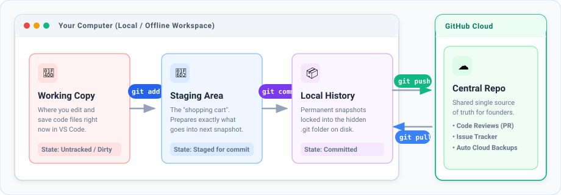

# Phase 0: Mental Model & Setup

> Created with 💖 by **FreeMatrix Studios** and **[@kuraigu](https://github.com/kuraigu)**

Welcome to the beginning. Before typing terminal commands, let's look at how files move in version control and get your computer ready.

---

## 1. How Git Works

When you work on a project with Git, files move through four areas:



1. **Working Copy:** Where you open and edit files in your editor (like VS Code).
2. **Staging Area (`git add`):** A preparation zone. You choose specifically which modified files belong in your next snapshot.
3. **Local History (`git commit`):** A permanent, saved snapshot on your computer.
4. **GitHub Cloud (`git push` / `git pull`):** The remote server where you share and review snapshots with teammates.

> [!NOTE]
> **Git vs. GitHub:**
> - **Git** is the program running locally on your computer. It takes snapshots and works completely offline.
> - **GitHub** is the website (`github.com`) where you store, share, and discuss code with others.

---

## 2. Open Your Terminal

The terminal is where you type commands to your computer:
- **macOS:** Press `Cmd + Space`, type **Terminal**, and press `Enter`.
- **Windows:** Press the `Windows key`, type **PowerShell** (or **Terminal**), and press `Enter`.
- **Linux:** Press `Ctrl + Alt + T`.

---

## 3. Check if Git is Installed

Type this command into your terminal and press `Enter`:

```bash
git --version
```

- **If you see a version number** (such as `git version 2.43.0`): Git is already installed. Proceed to section 5.
- **If your terminal says "command not found":** Follow the installation steps below.

---

## 4. Install Git

### On macOS
When you run `git --version`, macOS will usually open a prompt asking to install **Developer Tools**. Click **Install**. (If you use Homebrew, you can also run `brew install git`).

### On Windows
Download the free installer from the official site: [https://git-scm.com/download/win](https://git-scm.com/download/win). Run the `.exe` file and keep all default settings by clicking **Next**. This installs **Git Bash**, which provides a great terminal experience on Windows.

### On Linux (Ubuntu / Debian)
Run:
```bash
sudo apt update && sudo apt install git -y
```

---

## 5. Tell Git Your Name and Email

Git attaches an author name and email to every snapshot you make. Run these two commands (replace with your real name and the email attached to your GitHub account):

```bash
git config --global user.name "Your Name"
git config --global user.email "your-github-email@example.com"
```

Verify your settings:
```bash
git config user.name
git config user.email
```

> [!TIP]
> Make sure your email matches the primary email on your GitHub account so GitHub links your profile avatar to your work.

---

## Navigation

- **Previous:** None (You are at the start)
- **Next:** [Phase 1: Fork the Repository](phase-01-fork-repository.md)
