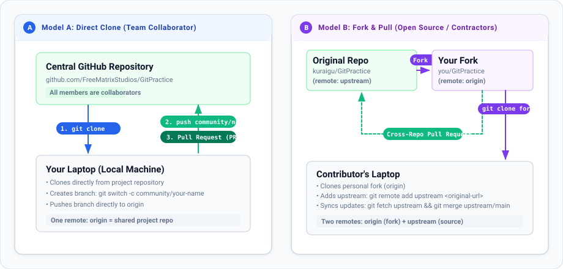

# Phase 1: Fork the Repository

> Created with 💖 by **FreeMatrix Studios** and **[@kuraigu](https://github.com/kuraigu)**

In this phase, you will create your own cloud copy of the project on GitHub. This is called a **Fork**.

---

## 1. What is a Fork?

A fork is an independent copy of a repository under your personal GitHub account.



Instead of editing the main project directly, you make your own copy first. Anything you do on your fork is completely isolated. You can experiment freely without any risk of breaking anyone else's files.

---

## 2. How to Fork on GitHub

1. Open the project repository on GitHub in your web browser.
2. In the top-right corner of the page, click the **Fork** button.
3. GitHub will ask where you want to fork the repository. Select your personal account.
4. Keep the repository name as suggested and click **Create fork**.
5. Wait a few seconds while GitHub creates your copy.

---

## 3. Verify Your Fork

Look at the URL in your browser address bar. It should now show:

```text
https://github.com/<your-username>/freematrix-git-practice
```

Underneath the repository title, GitHub will show:
```text
forked from kuraigu/freematrix-git-practice
```

You now have your own cloud copy ready for development.

---

## Navigation

- **Previous:** [Phase 0: Mental Model & Setup](phase-00-mental-model-and-setup.md)
- **Next:** [Phase 2: Clone Your Fork to Your Laptop](phase-02-clone-your-fork.md)
