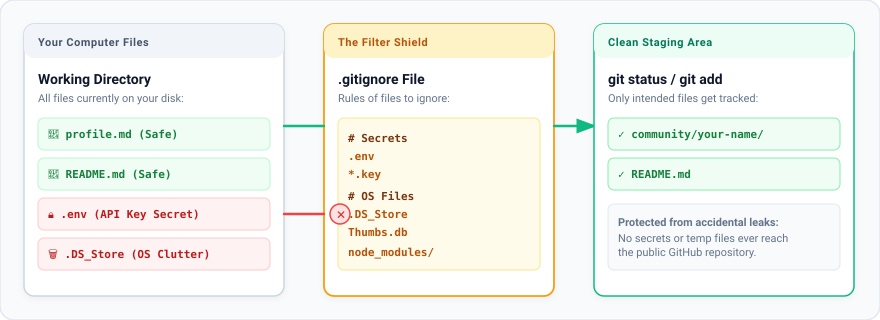

# Phase 5: Understanding .gitignore & Protecting Secrets

> Created with 💖 by **FreeMatrix Studios** and **[@kuraigu](https://github.com/kuraigu)**

In this phase, you will learn how to use `.gitignore` to keep private keys, passwords, and temporary files from ever being pushed to GitHub.

---

## 1. What is `.gitignore`?

A `.gitignore` file is a plain text file placed at the root of your project. It contains a list of file names, extensions, and folder patterns that Git should completely ignore.



When a file matches a rule in `.gitignore`, Git pretends the file does not exist. It will never show up in `git status`, it will never be added by `git add`, and it will never be uploaded to GitHub.

---

## 2. Why is This So Important?

Every year, developers and teams accidentally leak private API keys, database credentials, and passwords to public repositories because they ran `git add .` without a `.gitignore` file. Automated bots scan GitHub 24/7 looking for leaked keys.

Common things you should always ignore:
- **Secrets & API Keys:** `.env`, `.env.local`, `*.key`, `*.pem`, `credentials.json`
- **Operating System Clutter:** `.DS_Store` (macOS), `Thumbs.db` (Windows), `desktop.ini`
- **Large Dependency Directories:** `node_modules/` (JavaScript), `venv/` (Python), `vendor/` (PHP)
- **Log Files & Build Outputs:** `dist/`, `build/`, `*.log`

---

## 3. How `.gitignore` Syntax Works

Look at the [`.gitignore`](file:///A:/Development/GitPractice/.gitignore) file in this repository. Here is how the rules work:

```gitignore
# 1. Ignore an exact file:
.env

# 2. Ignore all files ending with an extension:
*.log
*.key

# 3. Ignore an entire folder and all its contents:
node_modules/
dist/

# 4. Lines starting with # are comments for humans to read:
# Secrets and environment configs
```

---

## 4. Hands-On Drill: The Disappearing Secret

Let's test how Git behaves when you ignore a file.

### Step 1: Create a mock secret file
In your terminal inside the project, create a temporary secret file:

```bash
# On macOS / Linux / Git Bash:
echo "SECRET_API_KEY=test_abc123" > secret_notes.txt

# On Windows PowerShell:
Set-Content -Path secret_notes.txt -Value "SECRET_API_KEY=test_abc123"
```

### Step 2: Check git status
Run:
```bash
git status
```
Git sees the file and lists `secret_notes.txt` in red under **"Untracked files"**. If you committed now, this secret would be saved.

### Step 3: Add it to `.gitignore`
Open `.gitignore` in your code editor. Scroll to the bottom and add this new line:

```gitignore
secret_notes.txt
```

Save `.gitignore`.

### Step 4: Check git status again
Run:
```bash
git status
```
Notice what happened: `secret_notes.txt` has completely vanished from `git status`! Git is now ignoring it.

### Step 5: Clean up your test file
Delete your test file from your computer:

```bash
# On macOS / Linux / Git Bash:
rm secret_notes.txt

# On Windows PowerShell:
Remove-Item secret_notes.txt
```

*(You can also discard your test edit to `.gitignore` by running `git restore .gitignore`).*

---

## 5. Emergency Fix: "I accidentally committed a secret file!"

If you accidentally committed a sensitive file, do **not** push to GitHub yet.

You can tell Git to stop tracking the file without deleting it from your computer:

```bash
git rm --cached <filename>
```

Then add `<filename>` to your `.gitignore`, and make a fresh commit:

```bash
git commit -m "chore: remove tracked secret file"
```

The file stays on your computer, but Git stops tracking it and removes it from future commits.

> [!CAUTION]
> If you already pushed a real API key or password to a public GitHub repository, assume it is compromised. Rotate or regenerate that key in your service provider's dashboard immediately.

---

## Navigation

- **Previous:** [Phase 4: Making Changes and Commits](phase-04-changes-and-commits.md)
- **Next:** [Phase 6: Four Essential Power Drills](phase-06-power-drills.md)
