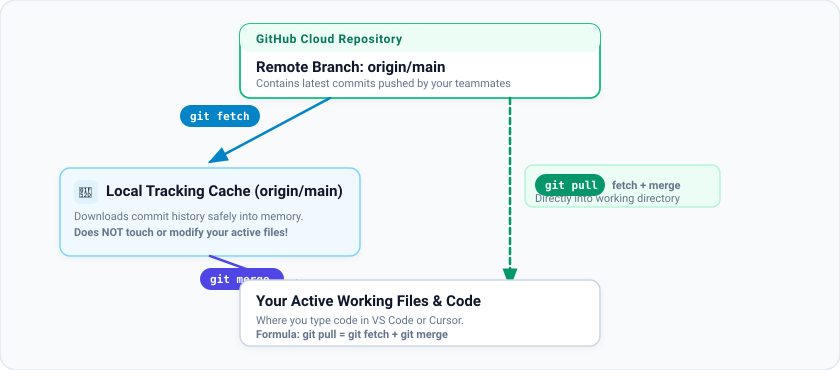

# Phase 7: Syncing and Pushing to GitHub

> Created with 💖 by **FreeMatrix Studios** and **[@kuraigu](https://github.com/kuraigu)**

In this phase, you will upload your local branch from your computer to your fork on GitHub, and learn how syncing works between teammates.

---

## 1. Push Your Branch to Your Fork

All the commits you created so far exist only on your laptop. Now upload them to your fork in the cloud:

```bash
git push -u origin community/your-name
```

Let's look at each part of that command:
- `git push`: Tells Git to upload your commits to a remote server.
- `-u` (short for `--set-upstream`): Tells Git to link this local branch to the branch on GitHub. After running this once, you only need to type `git push` for future updates on this branch.
- `origin`: The nickname for your fork on GitHub.
- `community/your-name`: The name of the branch to create on GitHub.

Output:
```text
Enumerating objects: 7, done.
To https://github.com/<your-username>/freematrix-git-practice.git
 * [new branch]      community/your-name -> community/your-name
Branch 'community/your-name' set up to track remote branch 'community/your-name' from 'origin'.
```

Your branch is now live in the cloud.

---

## 2. Downloading Updates: `git fetch` vs. `git pull`

When other people push code to GitHub, how do you bring their changes onto your computer?



- **`git fetch`** downloads information about what changed on GitHub into a hidden local cache. It does **not** touch or modify your active working files. Use it when you want to see what is new without risking any conflicts.
- **`git pull`** downloads the new commits **and immediately merges them** into your current files.

$$\text{git pull} = \text{git fetch} + \text{git merge}$$

> [!TIP]
> Before starting new work, always make sure your `main` branch is up to date:
> ```bash
> git switch main
> git pull origin main
> ```

---

## 3. What If a Push is Rejected?

If you try to push and see an error like this:

```text
! [rejected]        community/your-name -> community/your-name (fetch first)
error: failed to push some refs
```

This simply means someone else pushed changes to the same branch on GitHub while you were working. Git protects you from accidentally overwriting their work.

### How to resolve it:
1. Pull their updates first:
   ```bash
   git pull origin community/your-name
   ```
2. Git will merge their commits with your commits.
3. Push again:
   ```bash
   git push
   ```

> [!WARNING]
> Never run `git push --force` on shared branches. Force pushing tells GitHub to delete whatever is on the server and replace it with your local copy, which can permanently delete a teammate's work.

---

## Navigation

- **Previous:** [Phase 6: Four Essential Power Drills](phase-06-power-drills.md)
- **Next:** [Phase 8: Opening Your Pull Request & Review](phase-08-pull-request-and-review.md)
