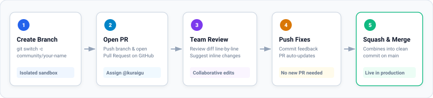

# Phase 8: Opening Your Pull Request & Review

> Created with 💖 by **FreeMatrix Studios** and **[@kuraigu](https://github.com/kuraigu)**

This is the final phase: proposing to merge the work from your personal fork into the main community repository.

---

## 1. The Pull Request Lifecycle

A Pull Request (PR) is a formal proposal to combine code from your branch into the main project. It gives teammates a chance to review the changes line by line, discuss ideas, and verify that everything works before it goes live.



---

## 2. Open Your Pull Request on GitHub

1. Open your fork in your web browser:  
   `https://github.com/<your-username>/freematrix-git-practice`
2. You will see a banner near the top saying: **"community/your-name had recent pushes - Compare & pull request"**. Click that button.  
   *(If you don't see the banner, click the **Pull Requests** tab, then click **New Pull Request**).*
3. **Verify the direction of the merge:**
   - **Base repository:** `kuraigu/freematrix-git-practice` | **base:** `main`
   - **Head repository:** `<your-username>/freematrix-git-practice` | **compare:** `community/your-name`
4. **Title:** Give your PR a clear title:  
   `Add community profile for <Your Name>`
5. **Assign Reviewer:** On the right sidebar, click **Reviewers** and select **`kuraigu`**.
6. Complete the checklist in the pull request description box.
7. Click the green **Create pull request** button.

---

## 3. The Review Guarantee

> [!IMPORTANT]
> **kuraigu will review your pull request.** If nothing is wrong, it will be merged into the project. If any small adjustments are needed, kuraigu will leave a comment directly on your pull request.

---

## 4. How to Update Your PR if Feedback is Given

If a reviewer leaves feedback asking for a small change, **you do not need to close the PR or open a new one**.

1. Make the requested edit in your local file on your computer.
2. Stage and commit the fix:
   ```bash
   git add community/your-name/profile.md
   git commit -m "docs: address review feedback on profile"
   ```
3. Push to your fork:
   ```bash
   git push
   ```
4. Look at your pull request on GitHub. GitHub automatically adds your new commit to the existing pull request!

Once approved, your pull request will be merged into `main`. Congratulations on completing the workshop!

---

## Support FreeMatrix Studios

If you enjoyed this walkthrough and want to support more free community resources, consider buying us a coffee on [Ko-fi](https://ko-fi.com/dippedinsoju) or sponsoring the project on GitHub!

---

## Navigation

- **Previous:** [Phase 7: Syncing and Pushing to GitHub](phase-07-syncing-and-pushing.md)
- **Reference:** [Quick Reference Cheat Sheet](cheat-sheet.md) | [Troubleshooting Guide](troubleshooting.md)
